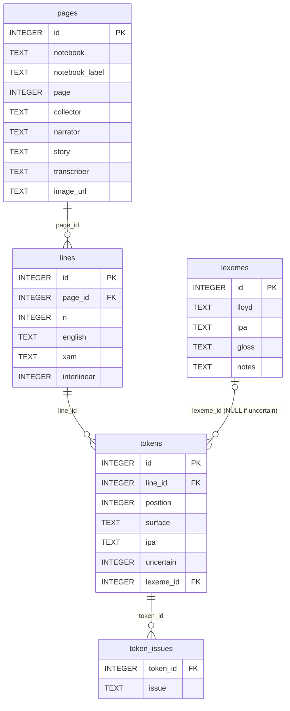

# /Xam notebook transcription: a proof of concept

> **Prototype / proof of concept only.** Three pages, transcribed by an AI
> model (Claude Opus 5.5). Expect misreadings; the IPA
> mapping is partly hypothetical.
>
> Honestly, I just wanted to know what's possible out of the box, with a
> mid-tier general-purpose model and no training. I assume a specialised
> handwriting model (e.g. Kraken/eScriptorium) trained on a few dozen/hundred
> corrected pages of Lloyd's hand, combined with the archive's full-resolution
> scans, would push the results to another level.

The handwritten notebooks of the extinct
[/Xam](https://en.wikipedia.org/wiki/%C7%80Xam_language) language, recorded by
Wilhelm Bleek and Lucy Lloyd in the 1870s, are digitised by the
[Digital Bleek and Lloyd](https://digitalbleeklloyd.uct.ac.za/) archive, but
mostly not transcribed. This prototype tests a pipeline: scan → transcription
→ IPA → searchable SQLite dictionary.

## Results and pages used

Lucy Lloyd's notebook BC_151_A2_1_009 (L-II-3: 383–475), story
*[What the people eat and wear (the Anteater's laws)](https://digitalbleeklloyd.uct.ac.za/metadata/stories/Lucy_Lloyd__xam_notebooks/story_200/index.html)*,
narrated by ǁkabbo.

| Page | Archive viewer | Scan (low resolution) | Transcription |
|------|----------------|-----------------------|---------------|
| 449 | [viewer](https://digitalbleeklloyd.uct.ac.za/metadata/books/Lucy_Lloyd__xam_notebooks/BC_151_A2_1_009/A2_1_9_00449.JPG/index.html) | [image](https://digitalbleeklloyd.uct.ac.za/collection/lloyd_xam_nb_lowres/BC_151_A2_1_009/A2_1_9_00449.JPG) | [A2_1_9_00449.json](transcriptions/A2_1_9_00449.json) |
| 450 | [viewer](https://digitalbleeklloyd.uct.ac.za/metadata/books/Lucy_Lloyd__xam_notebooks/BC_151_A2_1_009/A2_1_9_00450.JPG/index.html) | [image](https://digitalbleeklloyd.uct.ac.za/collection/lloyd_xam_nb_lowres/BC_151_A2_1_009/A2_1_9_00450.JPG) | [A2_1_9_00450.json](transcriptions/A2_1_9_00450.json) |
| 451 | [viewer](https://digitalbleeklloyd.uct.ac.za/metadata/books/Lucy_Lloyd__xam_notebooks/BC_151_A2_1_009/A2_1_9_00451.JPG/index.html) | [image](https://digitalbleeklloyd.uct.ac.za/collection/lloyd_xam_nb_lowres/BC_151_A2_1_009/A2_1_9_00451.JPG) | [A2_1_9_00451.json](transcriptions/A2_1_9_00451.json) |

All three pages as running parallel text (English, /Xam in Lloyd's spelling,
/Xam in IPA), with uncertainty statistics and a word list:
[`report.md`](report.md).

The scans are linked, not included, as their reuse terms are unclear.

## Running it

Requires Python 3.9+ and [Pillow](https://pypi.org/project/pillow/).

```sh
python3 xam_htr/fetch_pages.py BC_151_A2_1_009 449 451 --out data/raw
python3 xam_htr/crop_pages.py data/raw/*.jpg --out data/pages
python3 xam_htr/build_report.py transcriptions/*.json --out report.md
python3 xam_htr/build_lexicon_db.py transcriptions/*.json --out lexicon.sqlite
```

The transcription step (image → JSON) is not automated yet. The files in
`transcriptions/` were produced interactively with Claude.

## Transcription conventions

Transcriptions keep Lloyd's spelling as written, line by line, English and
/Xam separately; `[...?]` marks uncertain readings. `to_ipa.py` generates IPA
following Naumann (2016, Table 1), with click accompaniments analysed as
clusters after Güldemann (2001). It uses one rule table, each rule marked
*confident* or *hypothesis*:

| Lloyd | IPA (Naumann) | Orthography (Naumann) | |
|-------|---------------|-----------------------|---|
| ǀk    | ǀ             | ǀ                     | plain click |
| ǀkh   | ǀʰ            | ǀh                    | aspirated click (hypothesis) |
| ǀk͓    | ǀχ            | ǀx                    | click + uvular fricative (hypothesis) |
| ǀn    | ǀ̃             | nǀ                    | nasal click |
| tt    | tʼ            | t'                    | ejective (hypothesis) |


Full mapping: [`xam_htr/TRANSCRIPTION_GUIDE.md`](xam_htr/TRANSCRIPTION_GUIDE.md).

## The dictionary database

`lexicon.sqlite` is generated from `transcriptions/`.

| Table / view | Contents |
|---|---|
| `pages` | notebook, page, collector, narrator, story, transcriber, scan URL |
| `lines` | each ruled line: English column, /Xam column, interlinear flag |
| `tokens` | every /Xam token in reading order: surface form, IPA, uncertain flag, lexeme |
| `lexemes` | distinct word forms: Lloyd's spelling, IPA, gloss (empty, could also be automated), notes (empty) |
| `token_issues` | why a token's IPA conversion is unresolved |
| `concordance` | view: every token with its line, page, story and narrator |

### Entity-relationship diagram



Open it with `sqlite3 lexicon.sqlite` (use `.headers on` and `.mode markdown`
for tabular output) or any SQLite browser.

### Example queries

Every occurrence of *ǃnwáin* "lynx", with its line in both columns:

```sql
SELECT t.*, l.english, l.xam
FROM tokens t JOIN lines l ON l.id = t.line_id
WHERE t.lexeme_id = (SELECT id FROM lexemes WHERE lloyd = 'ǃnwáin');
```

| id  | line_id | position | surface    | ipa        | uncertain | lexeme_id | english          | xam                       |
|-----|---------|----------|------------|------------|-----------|-----------|------------------|---------------------------|
| 18  | 5       | 3        | `ǃnwáin_`  | `ǃ̃wáin_`  | 0         | 17        | the lynx         | `ē, _ǀkŭ ǃnwáin_ ×nē`     |
| 41  | 11      | 2        | `ǃnwáin_`  | `ǃ̃wáin_`  | 0         | 17        | lynx went &      | `_ǀkŭ ǃnwáin_ ×[nḗ?]`     |
| 133 | 35      | 1        | `_ǃnwáin`  | `_ǃ̃wáin`  | 0         | 17        | shells. the lynx | `_ǃnwáin yăng_ ắ, ssing` |

All words containing a nasal click (click letter + tilde):

```sql
SELECT lloyd, ipa FROM lexemes WHERE ipa GLOB '*[ʘǀǁǃǂ]̃*' ORDER BY lloyd;
```

| lloyd  | ipa    |
|--------|--------|
| ǀnĕ    | ǀ̃ĕ     |
| ǃnwáin | ǃ̃wáin  |
